# Technical Architecture & Event Specifications

This document details the architectural design, event lifecycles, and data contracts connecting **AWS DevOps Agent** and **Atlassian Jira Cloud**.

---

## 1. System Architecture & Bi-Directional Event Flow

This solution operates as a bidirectional, closed-loop incident bridge:

1. **Inbound Trigger (Jira ➡️ AWS DevOps Agent)**: Trigger AWS DevOps Agent incident investigations whenever an incident ticket is submitted in Jira or commented with `/investigate`.
2. **Outbound Creation & Updates (Non-Jira Sources ➡️ AWS DevOps Agent ➡️ Jira)**: Whenever an investigation is initiated in AWS DevOps Agent by non-Jira sources (CloudWatch Alarms, AWS Console, CLI, automated EventBridge rules, third-party APM tools), it automatically creates a corresponding tracking ticket in Jira and streams investigation progress and Root Cause Analysis (RCA) directly into it.

```text
                                  ┌──────────────────────────────┐
                                  │   Non-Jira Alert Sources     │
                                  │ (CloudWatch, Console, CLI)   │
                                  └──────────────┬───────────────┘
                                                 │ 
                                                 ▼
┌──────────────────────┐             ┌────────────────────────┐             ┌──────────────────────┐
│                      │   Webhook   │                        │  REST API   │                      │
│ Atlassian Jira Cloud │────────────►│  Webhook Receiver      │────────────►│ AWS DevOps Agent     │
│                      │  (/invest.) │  Lambda (Inbound)      │  (Backlog)  │ Space                │
│                      │◄────────────│                        │             │                      │
│                      │  Ack Comm.  └────────────────────────┘             └──────────┬───────────┘
│                      │                                                               │
│                      │◄─────────────────────────────────────────────┐                │ aws.aidevops
│                      │  Issue Created, Diagnostic Logs, RCA Posted  │                ▼
│                      │                                      ┌───────┴──────┐  ┌──────────────┐
│                      │                                      │ EventHandler │◄─│ Amazon       │
│                      │                                      │ Lambda       │  │ EventBridge  │
│                      │                                      └───────┬──────┘  └──────────────┘
│                      │                                              │
│                      │                                              ▼
│                      │                                      ┌──────────────┐
│                      │                                      │ DynamoDB     │
│                      │                                      │ State Table  │
└──────────────────────┘                                      └──────────────┘
```

### Synergy with Atlassian Remote MCP Server (`https://mcp.atlassian.com/v2/mcp`)
AWS DevOps Agent supports registering the **Atlassian Remote MCP Server** as a **Capability Provider** inside your Agent Space.
- **Atlassian Remote MCP Server (In-Investigation Tools)**: Used *inside* the agent's AI reasoning loop to query recent Jira deployments, search Confluence runbooks, and pull context from existing work items.
- **Amazon EventBridge Integration (Lifecycle Orchestration)**: Used *outside* the agent to automatically create tracking tickets on alert triggers, update DynamoDB state, stream step-by-step progress comments, post final RCA summaries, and handle inbound webhooks (`/investigate`).

Together, they form a complete closed-loop incident management ecosystem.

---

## 2. EventBridge Event Lifecycle Specifications

AWS DevOps Agent emits events under the source namespace `aws.aidevops`.

### 2.1 Event: `Investigation Created`
Emitted immediately when an anomaly or incident triggers an investigation.

```json
{
  "version": "0",
  "id": "c1f7b76a-1234-5678-9abc-def012345678",
  "detail-type": "Investigation Created",
  "source": "aws.aidevops",
  "account": "123456789012",
  "time": "2026-11-26T12:00:00Z",
  "region": "us-east-1",
  "resources": [
    "arn:aws:aidevops:us-east-1:123456789012:agentspace/aspc-0a1b2c3d4e5f6g7h8"
  ],
  "detail": {
    "metadata": {
      "agent_space_id": "aspc-0a1b2c3d4e5f6g7h8",
      "task_id": "tsk-0987654321fedcba",
      "execution_id": "ex-1234567890abcdef"
    },
    "data": {
      "task_type": "INVESTIGATION",
      "status": "PENDING",
      "symptom": "Elevated 5xx Error Rate (>15%) on API Gateway endpoint /v1/checkout",
      "priority": "HIGH"
    }
  }
}
```

**Lambda Behavior**:
1. Creates a new Jira issue via `POST /rest/api/3/issue`.
2. Formats description using Atlassian Document Format (ADF) with deep link to AWS DevOps Agent Space.
3. Saves mapping `{ "taskId": "tsk-0987654321fedcba", "jiraIssueKey": "OPS-142", ... }` into DynamoDB.

---

### 2.2 Event: `Investigation In Progress`
Emitted periodically as the agent executes diagnostic subtasks (correlating logs, querying X-Ray traces, checking CloudTrail).

```json
{
  "detail-type": "Investigation In Progress",
  "source": "aws.aidevops",
  "detail": {
    "metadata": {
      "task_id": "tsk-0987654321fedcba"
    },
    "data": {
      "status": "IN_PROGRESS",
      "phase": "Correlating CloudWatch Metrics and analyzing ECS task stderr logs"
    }
  }
}
```

**Lambda Behavior**:
1. Looks up `jiraIssueKey` from DynamoDB using `taskId`.
2. Appends an ADF progress note comment via `POST /rest/api/3/issue/{key}/comment`.

---

### 2.3 Event: `Investigation Completed`
Emitted when diagnostic analysis finishes and Root Cause Analysis (RCA) is synthesized.

```json
{
  "detail-type": "Investigation Completed",
  "source": "aws.aidevops",
  "detail": {
    "metadata": {
      "agent_space_id": "aspc-0a1b2c3d4e5f6g7h8",
      "task_id": "tsk-0987654321fedcba",
      "execution_id": "ex-1234567890abcdef"
    },
    "data": {
      "task_type": "INVESTIGATION",
      "status": "COMPLETED",
      "root_cause": "Database connection pool exhaustion on rds-postgres-orders-prod triggered by unindexed query.",
      "affected_resources": [
        "arn:aws:rds:us-east-1:123456789012:db:rds-postgres-orders-prod"
      ],
      "recommendations": [
        "Deploy index on orders(created_at, status)",
        "Increase RDS max_connections parameter"
      ]
    }
  }
}
```

**Lambda Behavior**:
1. Queries DynamoDB for `jiraIssueKey`.
2. Builds structured ADF comment with Success Panel, Findings, Affected Resources, and Action Items.
3. Adds label `rca-completed`.
4. Transitions issue to `In Progress` / `Under Review`.
5. Updates DynamoDB status to `COMPLETED`.

---

## 3. DynamoDB Data Model

Table Name: `devops-agent-jira-mappings`  
Billing Mode: `PAY_PER_REQUEST` (On-Demand)

| Attribute | Type | Description |
| :--- | :--- | :--- |
| `taskId` (**Partition Key**) | `String` | Unique AWS DevOps Agent task identifier (`tsk-xxxx`). |
| `jiraIssueKey` | `String` | Jira issue identifier (e.g. `OPS-142`). |
| `agentSpaceId` | `String` | DevOps Agent Space identifier. |
| `executionId` | `String` | DevOps Agent execution identifier. |
| `status` | `String` | State: `INVESTIGATION_CREATED`, `IN_PROGRESS`, `COMPLETED`, `FAILED`. |
| `summary` | `String` | Summary title of the investigation. |
| `createdAt` | `String` | ISO 8601 UTC timestamp of creation. |
| `updatedAt` | `String` | ISO 8601 UTC timestamp of last update. |

---

## 4. Idempotency Architecture & Duplicate Ticket Prevention

To operate safely at enterprise scale without creating duplicate tickets or infinite event loops, this solution enforces **four layers of strict idempotency guards**:

```mermaid
flowchart TD
    subgraph Outbound["1. Outbound: EventBridge ➔ Jira"]
        E1[EventBridge 'Investigation Created' Arrives] --> D1{Is taskId in DynamoDB?}
        D1 -- Yes: Already Mapped --> S1[Exit: Skip Duplicate Issue Creation]
        D1 -- No: New Task --> C1[Create Jira Ticket KAN-X]
        C1 --> W1[Save taskId ↔ KAN-X in DynamoDB]
    end

    subgraph Inbound["2. Inbound: Jira ➔ AWS DevOps Agent"]
        J1[Jira Webhook 'issue_updated' Arrives] --> D2{Is JIRA#KAN-X active in DynamoDB?}
        D2 -- Yes & no /investigate command --> S2[Exit: Ignore Routine Field Edit]
        D2 -- No or explicit /investigate --> C2[Launch Investigation Task]
        C2 --> W2[Save JIRA#KAN-X as IN_PROGRESS in DynamoDB]
    end

    subgraph Echo["3. Echo Loop Prevention (Ping-Pong Guard)"]
        J3[Ticket created in Jira] --> A1[Webhook creates task tsk-123 & writes mapping to DynamoDB]
        A1 --> B1[DevOps Agent natively emits 'Investigation Created' to EventBridge]
        B1 --> D3{EventHandler checks DynamoDB for tsk-123}
        D3 -- Found: Originated from Jira --> S3[Skip: Do NOT create duplicate Jira ticket]
    end
```



### 1. Outbound Event Deduplication (EventBridge At-Least-Once Delivery)
Amazon EventBridge guarantees **at-least-once** delivery, meaning network retries could theoretically deliver duplicate `Investigation Created` events for the same task.
* **Mechanism**: When `Investigation Created` arrives at `event_handler.py`, the Lambda queries DynamoDB for `taskId`.
* **Guard**: If a mapping record already exists for that `taskId`, Lambda logs `Idempotency Guard: Task already mapped to Jira issue. Skipping duplicate creation.` and immediately exits without calling Jira API.

### 2. Duplicate RCA Comment Prevention
When an investigation finishes, EventBridge delivers `Investigation Completed`.
* **Mechanism**: Lambda checks if the DynamoDB state is already `COMPLETED`.
* **Guard**: If `status == "COMPLETED"`, Lambda skips comment creation, preventing duplicate RCA comments from being posted if EventBridge retries delivery.

### 3. Inbound Jira Update Deduplication (Routine Edits vs. New Alerts)
In Jira, engineers frequently edit tickets (re-assigning teammates, changing priority, dragging cards across Kanban columns, or writing standard comments). Each action sends a `jira:issue_updated` webhook event.
* **Mechanism**: DynamoDB stores a reverse state record: `taskId = "JIRA#" + issue_key`.
* **Guard**: When `jira:issue_updated` arrives at `webhook_receiver.py`, it inspects `JIRA#{issue_key}`. If an active investigation (`IN_PROGRESS` or `INVESTIGATION_QUEUED`) is already running for this ticket, it suppresses duplicate task creation (`HTTP 200 {"status": "already_active"}`).
* **Override**: Only an explicit slash command (`/investigate`) overrides this to re-run an investigation on demand.

### 4. The "Ping-Pong" Echo Loop Guard (Bidirectional Loop Prevention)
Without state tracking, a bidirectional integration could enter an infinite loop:
> Jira creates a ticket ➔ Webhook triggers DevOps Agent ➔ DevOps Agent emits EventBridge event ➔ EventHandler creates *another* Jira ticket ➔ That triggers another webhook...

**How the loop is broken**:
1. When a Jira ticket triggers an investigation, `webhook_receiver.py` writes `taskId ➔ issue_key` into DynamoDB **before** the agent starts.
2. When AWS DevOps Agent begins and publishes its native `Investigation Created` event to EventBridge, `event_handler.py` picks it up and checks DynamoDB.
3. It finds that `taskId` is **already mapped** to the Jira ticket that initiated it.
4. It skips ticket creation entirely, breaking the loop!

### 5. AWS API Client-Token Idempotency
When `webhook_receiver.py` dispatches `create_backlog_task` to the AWS DevOps Agent API, it provides a deterministic client token (`clientToken=f"jira-{issue_key}-{timestamp}"`). This ensures that even if AWS API calls are retried over unstable networks, AWS DevOps Agent will never spawn duplicate backlog tasks.

---

## 5. Security & Encryption Standards

1. **Secrets at Rest**: Stored in AWS Secrets Manager, encrypted with AWS KMS. Secret strings are never printed in CloudWatch logs.
2. **Secrets in Transit**: Encrypted over HTTPS using TLS 1.3 to Jira Cloud REST API endpoints.
3. **Data Mapping Table**: DynamoDB is encrypted with AWS managed keys and has Point-In-Time Recovery (PITR) enabled.
4. **Execution Permissions**: IAM execution role strictly scoped to table ARN and secret ARN.
