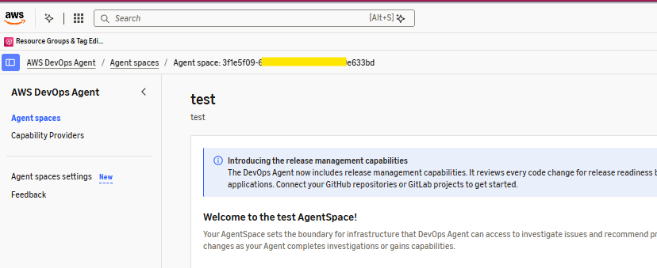
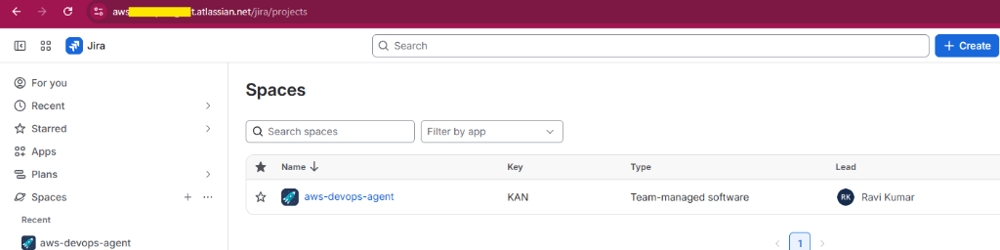

# Step-by-Step Installation & Deployment Guide

This guide details the complete walkthrough for installing, configuring, and verifying the **AWS DevOps Agent to Jira Cloud Integration**.

---

## 1. Prerequisites Checklist

Before beginning deployment, ensure you have the following:

- [ ] **AWS CloudShell Access**: Login to your AWS Management Console and launch CloudShell in your target region (e.g. `us-east-1` or `us-west-2`).
- [ ] **IAM Permissions**: Permission to create and manage:
  - AWS CloudFormation Stacks (`cloudformation:*`)
  - AWS Lambda Functions & Function URLs (`lambda:*`)
  - Amazon DynamoDB Tables (`dynamodb:*`)
  - AWS Secrets Manager Secrets (`secretsmanager:*`)
  - Amazon EventBridge Rules (`events:*`)
  - AWS IAM Roles & Policies (`iam:*`)
- [ ] **AWS DevOps Agent Space**: An active DevOps Agent Space in your region.
- [ ] **Atlassian Jira Cloud Account**:
  - Admin access to Atlassian Jira Cloud.
  - A designated project (e.g., `OPS`, `INC`, or `ITSM`).
  - An Atlassian Cloud API Token for authentication.

---

## 2. Generating an Atlassian API Token

1. Log in to **[Atlassian Security > API Tokens](https://id.atlassian.com/manage-profile/security/api-tokens)**.
2. Click **Create API token** *(choose the standard option, not "with scopes", so it inherits basic auth permissions)*.
3. In the creation modal:
   - **Name**: Enter `aws_devops_agent`.
   - **Expires on**: Select your preferred expiration date (up to 1 year).

<p align="center">
  
</p>

4. Click **Create**.
5. Copy and store the generated token immediately; Atlassian will not display it again. You will paste this token into the CloudShell setup wizard.

---

## 3. Verifying Your Jira API Key (Pre-Flight Check)

Before running the deployment wizard, you can verify your credentials directly using `curl`:

```bash
# Verify authentication
curl -s -i -u "YOUR_EMAIL:YOUR_API_TOKEN" \
  -H "Accept: application/json" \
  "https://YOUR_ORG.atlassian.net/rest/api/3/myself"

# Verify project access
curl -s -i -u "YOUR_EMAIL:YOUR_API_TOKEN" \
  -H "Accept: application/json" \
  "https://YOUR_ORG.atlassian.net/rest/api/3/project/YOUR_PROJECT_KEY"
```

A successful response returns `HTTP/2 200` with user details (such as `displayName` and `accountId`).

---

## 4. Deployment using AWS CloudShell (Interactive)

### Step 3.1: Launch AWS CloudShell
1. Open the [AWS Management Console](https://console.aws.amazon.com/).
2. Click the **CloudShell icon** (`>_`) in the top navigation bar.

### Step 3.2: Clone the Project
```bash
git clone https://github.com/ksravikumar2005/devops-agent-jira.git
cd devops-agent-jira
```

### Step 3.3: Execute Setup Wizard
```bash
bash cloudshell-setup.sh
```

### Step 3.4: Follow the Interactive Prompts
1. **Target Region**: Confirm your AWS region (default: current region).
2. **Agent Space ID**: The wizard attempts to discover your Agent Space using `aws aidevops list-agent-spaces`. If found, press `Enter` to use it, or copy/paste your Space ID.
   > **Tip**: You can copy your Agent Space ID (e.g. `3f1e5f09-659d-4073-a7a5-2b5ca9e633bd`) directly from the AWS Console top breadcrumb navigation under **AWS DevOps Agent > Agent spaces > Agent space: [ID]**:
   >
   > <p align="center">
   >   
   > </p>
3. **Jira Base URL**: Enter your Atlassian Cloud domain, e.g., `https://mycompany.atlassian.net` (you can copy the base domain directly from your browser's address bar up to `.atlassian.net`):
   > <p align="center">
   >   
   > </p>
   > *(Note: Accidental trailing slashes like `https://mycompany.atlassian.net/` are automatically sanitized and stripped to prevent `//` path bugs).*
4. **Jira User Email**: Enter the email of the Jira administrator or service account.
5. **Jira API Token**: Paste your API token (input is masked for security).
6. **Jira Project Key**: Enter the key of the project where incident tickets should be created (e.g., `OPS`).
7. **Jira Issue Type**: Choose `Incident`, `Bug`, or `Task` (default: `Incident`).

The script automatically executes a live pre-flight check against Jira REST API v3 `/rest/api/3/myself` and `/rest/api/3/project/{KEY}` to verify connectivity before deploying any AWS resources.

---

## 4. Verification & Testing Scenarios

Upon successful deployment, the script presents two live verification scenarios:

```text
==> [6/6] End-to-End Integration Verification
Choose an automated scenario to verify the live integration:

  1) Outbound: Trigger REAL Investigation in AWS DevOps Agent
     Creates an authentic backlog task in your DevOps Agent Space using AWS CLI.
     DevOps Agent starts analyzing, emits native 'aws.aidevops' to EventBridge,
     creates a live Jira ticket in KAN, and posts diagnostic updates & RCA.

  2) Inbound: Create Incident in Jira & Trigger AWS DevOps Agent
     Creates a new live incident ticket in Jira (KAN) via REST API.
     The webhook receiver triggers AWS DevOps Agent to start an investigation,
     acknowledges with the Task ID, and sends investigation details back to Jira.

  3) Skip Verification (Complete setup directly)

Select verification scenario [1/2/3] (default: 1):
```

---

## 5. Register Inbound Webhook in Jira Cloud (Bi-Directional Flow)

To enable Jira to automatically notify AWS DevOps Agent when tickets are created or commented with `/investigate`:

1. Copy your deployed `JiraWebhookUrl`:
   ```bash
   aws cloudformation describe-stacks \
     --stack-name devops-agent-jira-integration \
     --query "Stacks[0].Outputs[?OutputKey=='JiraWebhookUrl'].OutputValue" \
     --output text
   ```
   *(Example: `https://3ra5eo6jjd5orsf4xvtwy6onbe0dvkyr.lambda-url.us-east-1.on.aws/`)*
2. In Atlassian Jira Cloud:
   - Click the gear icon (**Settings ⚙️**) in the top right header.
   - Navigate to **System > Webhooks** (under *Advanced* in the left sidebar).
   - Click **+ Create a Webhook** (top right).
   - Configure:
     - **Name**: `AWS DevOps Agent Integration`
     - **Status**: `Enabled`
     - **URL**: Paste your `JiraWebhookUrl`.
     - **Issue related events**:
       - Check **Issue**: `created`, `updated`
       - Check **Comment**: `created`
     - *(Optional JQL Filter)*: `project = "KAN"`
   - Click **Save**.

---

## 6. Verification: Real Investigation vs. Synthetic Testing

### Option A: Trigger a REAL DevOps Agent Investigation (Recommended)
Trigger an actual backlog task of type `INVESTIGATION` inside your live AWS DevOps Agent Space using the official AWS CLI. AWS DevOps Agent will autonomously analyze your infrastructure and emit authentic `aws.aidevops` lifecycle events (`Investigation Created`, `Investigation In Progress`, `Investigation Completed`) to EventBridge:

```bash
bash scripts/create-real-investigation.sh
```

Or invoke directly via the official AWS CLI:
```bash
aws devops-agent create-backlog-task \
    --agent-space-id "3f1e5f09-659d-4073-a7a5-2b5ca9e633bd" \
    --task-type "INVESTIGATION" \
    --title "Investigate Latency Spike on Order Processing Microservice" \
    --description "Autonomous root cause analysis across CloudWatch, X-Ray, and ECS logs" \
    --priority "HIGH" \
    --region "us-east-1"
```

### Option B: Synthetic Test Suite
You can manually trigger synthetic tests anytime using the included test runner:

```bash
bash scripts/test-integration.sh
```

Or test Lambda directly:
```bash
bash scripts/test-integration.sh --direct
```

Or trigger using the Python CLI simulator:
```bash
python3 scripts/simulate-investigation.py --region us-east-1 --space-id 3f1e5f09-659d-4073-a7a5-2b5ca9e633bd
```

---

## 6. CloudWatch Logs Inspection

To observe live Lambda processing and API payloads:

```bash
aws logs tail "/aws/lambda/devops-agent-jira-integration-EventHandler" --follow
```

---

## 7. Teardown & Clean Up

To delete all created resources (CloudFormation stack, Secrets Manager secret, DynamoDB table):

### Via Setup Script:
```bash
# Interactive confirmation
bash cloudshell-setup.sh --cleanup

# Automated (skip confirmation prompt)
bash cloudshell-setup.sh --cleanup --force
```

### Via Cleanup Script:
```bash
bash scripts/cleanup.sh
```
