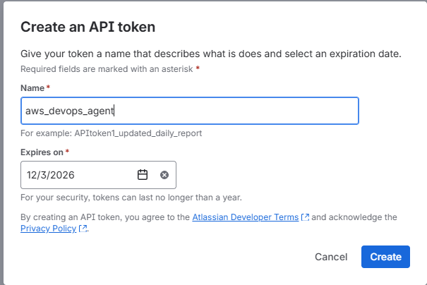
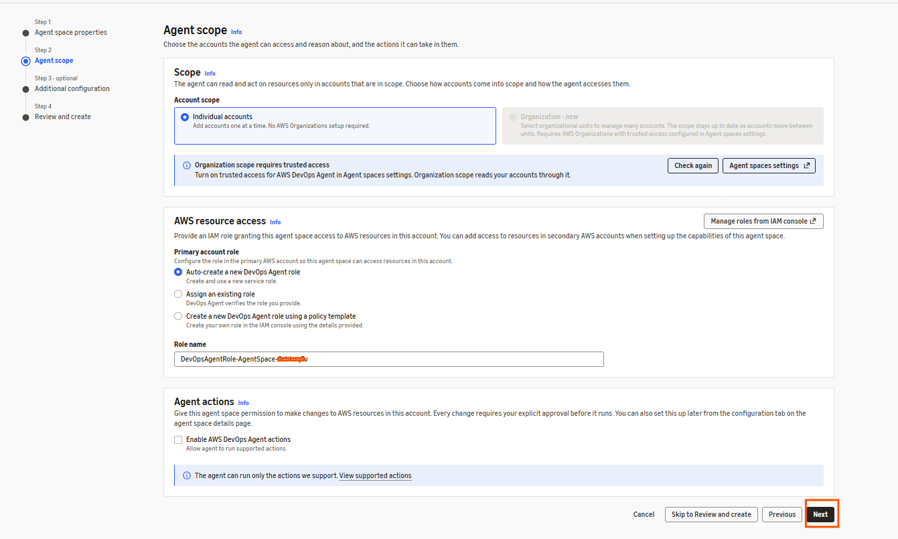
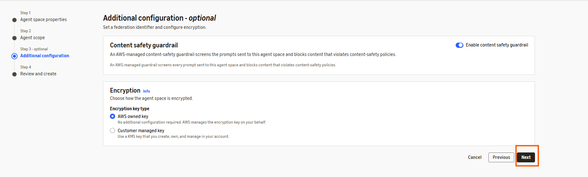
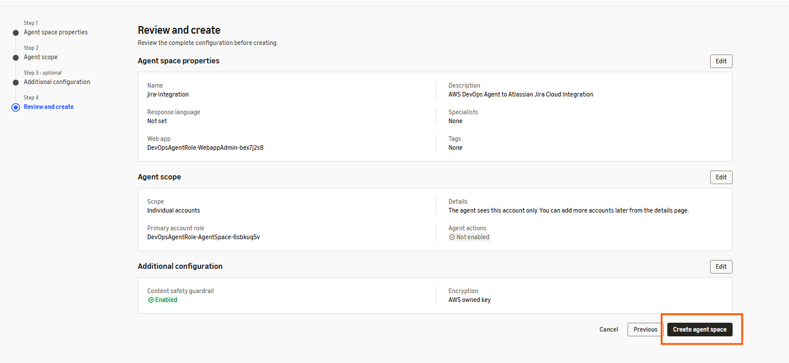
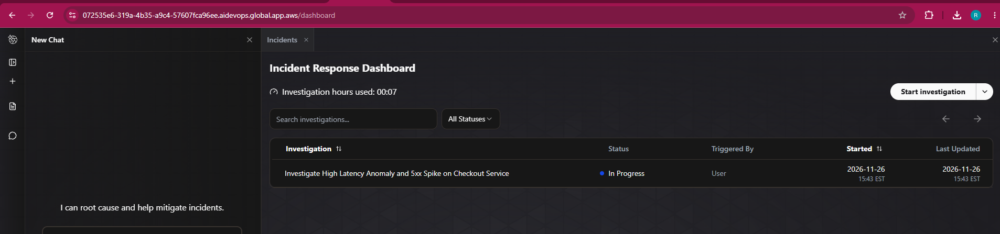

# Step-by-Step Installation & Deployment Guide

This guide details the complete walkthrough for installing, configuring, and verifying the **AWS DevOps Agent to Jira Cloud Integration**.

---

## 📋 Prerequisites Checklist

Before beginning deployment, ensure you have the following:

- [ ] **AWS CloudShell Access**: Login to your AWS Management Console and launch CloudShell in your target region (e.g. `us-east-1`).
- [ ] **IAM Permissions**: Permission to create and manage:
  - AWS CloudFormation Stacks (`cloudformation:*`)
  - AWS Lambda Functions & Function URLs (`lambda:*`)
  - Amazon DynamoDB Tables (`dynamodb:*`)
  - AWS Secrets Manager Secrets (`secretsmanager:*`)
  - Amazon EventBridge Rules (`events:*`)
  - AWS IAM Roles & Policies (`iam:*`)
- [ ] **AWS DevOps Agent Space**: An active DevOps Agent Space in your region.
- [ ] **Atlassian Jira Cloud Account**:
  - Admin access to Atlassian Jira Cloud.
  - A designated project (e.g., `KAN`, `OPS`, or `ITSM`).
  - An Atlassian Cloud API Token for authentication.

---

## Step 1: Set Up Atlassian Jira Cloud & API Credentials

1. **Access Jira Cloud**: Sign in to your Atlassian site (e.g., `https://aws-devops-agent.atlassian.net`).
   > [!TIP]
   > You can copy your Jira Base URL directly from your browser's address bar:
   >
   > <p align="center">
   >   
   > </p>

2. **Designate a Project**: Identify your target Project Key (e.g., `KAN`).
3. **Generate an Atlassian API Token**:
   - Log in to **[Atlassian Security > API Tokens](https://id.atlassian.com/manage-profile/security/api-tokens)**.
   - Click **Create API token** *(choose the standard option, not "with scopes", so it inherits basic auth permissions)*.
   - **Name**: Enter `aws_devops_agent`.
   - **Expires on**: Select your preferred expiration date (up to 1 year).

   <p align="center">
     
   </p>

   - Click **Create**.
   - Copy and store the generated token immediately.

4. **Verify Connectivity (Pre-Flight Check)**:
   Run these curl checks from CloudShell or your terminal to verify API authentication and project permissions:
   ```bash
   # Verify authentication
   curl -s -i -u "YOUR_EMAIL:YOUR_API_TOKEN" \
     -H "Accept: application/json" \
     "https://mycompany.atlassian.net/rest/api/3/myself"

   # Verify project access
   curl -s -i -u "YOUR_EMAIL:YOUR_API_TOKEN" \
     -H "Accept: application/json" \
     "https://mycompany.atlassian.net/rest/api/3/project/KAN"
   ```

5. **Issue Types & Permissions**:
   - **Team-managed projects**: Use issue type **`Task`** or **`Bug`** (the integration auto-detects this).
   - **Company-managed / ITSM projects**: Use **`Incident`**, **`Bug`**, or **`Task`**.
   - Ensure custom fields are not marked as strictly *Required* on the issue creation screen.

---

## Step 2: Set Up AWS DevOps Agent Space

1. In the AWS Management Console, navigate to **AWS DevOps Agent** in your target region (e.g. `us-east-1`).
2. Open **Agent spaces** and click the **Create agent space** button:

   <p align="center">
     
   </p>

3. **Step 1 - Agent Space Properties**:
   - **Agent space name**: Enter a name (e.g., `jira-integration` or `DevOpsSpace-Prod`).
   - **Description**: Enter a description (e.g., `AWS DevOps Agent to Atlassian Jira Cloud Integration`).
   - **Enable web app**: Select *Auto-create a new DevOps Agent role*.
   - Click **Next**.

   <p align="center">
     
   </p>

4. **Step 2 - Agent Scope**:
   - **Account scope**: Select *Individual accounts* (or Organization scope if managing across AWS Organizations).
   - **Primary account role**: Select *Auto-create a new DevOps Agent role*.
   - Click **Next**.

   <p align="center">
     
   </p>

5. **Step 3 - Additional Configuration (Optional)**:
   - **Content safety guardrail**: Enabled by default to screen prompts and violations.
   - **Encryption**: Keep *AWS owned key* (or select Customer managed KMS key).
   - Click **Next**.

   <p align="center">
     
   </p>

6. **Step 4 - Review and Create**:
   - Review your settings and click **Create agent space**.

   <p align="center">
     
   </p>

7. **Locate your Agent Space Name or Space ID**:
   Once created, you can use either your **Agent Space Name** (e.g., `jira-integration`) or your **Space ID UUID**:
   > [!TIP]
   > You can copy the Space ID (UUID format, e.g. `072535e6-319a-4b35-a9c4-57607fca96ee`) directly from the console's top breadcrumb navigation:
   >
   > <p align="center">
   >   
   > </p>
   > *(The setup script supports entering either the Space Name or the Space ID and automatically resolves names to the underlying ID).*

---

## Step 3: Deploy via AWS CloudShell

### 3.1: Launch CloudShell & Run Setup
1. Open the [AWS Management Console](https://console.aws.amazon.com/) in your target region (`us-east-1`).
2. Click the **CloudShell icon** (`>_`) in the top navigation bar.
3. Clone the repository and execute the setup wizard:
   ```bash
   git clone https://github.com/ksravikumar2005/devops-agent-jira.git
   cd devops-agent-jira
   bash cloudshell-setup.sh
   ```

   <p align="center">
     
   </p>

### 3.2: Follow the Interactive Prompts
1. **Target Region**: Confirm your AWS region (`us-east-1`).
2. **Agent Space**: Enter your Space Name (`jira-integration`) or Space ID.
3. **Jira Base URL**: Enter your Atlassian Cloud domain (e.g., `https://aws-devops-agent.atlassian.net`).
4. **Jira User Email**: Enter your Atlassian login email (`admin@mycompany.com`).
5. **Jira API Token**: Paste your generated Atlassian API token.
6. **Jira Project Key**: Enter your target project key (`KAN`).
7. **Jira Issue Type**: The script detects available types (`Epic`, `Task`, `Story`, `Feature`, `Bug`) and automatically selects `Task` for team-managed projects.

   <p align="center">
     
   </p>

### 3.3: Automated Live Verification
At the end of deployment, the wizard presents verification options:
- Select **1** to run **Outbound Flow**: Triggers a real investigation in AWS DevOps Agent, routes it to EventBridge, creates a live ticket in Jira (`KAN-5`), and outputs your secured Webhook URL!

   <p align="center">
     
   </p>

---

## Step 4: Register Secured Webhook in Jira Cloud

To allow Jira to securely notify AWS DevOps Agent, register the secured webhook:

### 4.1: Retrieve the Secured Webhook URL
```bash
WEBHOOK_URL=$(aws cloudformation describe-stacks \
  --stack-name devops-agent-jira-integration \
  --query "Stacks[0].Outputs[?OutputKey=='JiraWebhookUrl'].OutputValue" \
  --output text)

WEBHOOK_TOKEN=$(aws secretsmanager get-secret-value \
  --secret-id "devops-agent/jira-credentials" \
  --query "SecretString" --output text | jq -r '.webhook_secret_token')

echo -e "\nSecured Webhook URL:\n${WEBHOOK_URL}?token=${WEBHOOK_TOKEN}\n"
```

*(You can also verify the raw `JiraWebhookUrl` output directly in the AWS CloudFormation Console)*:

<p align="center">
  
</p>

### 4.2: Register the Webhook in Jira
1. In Jira, click the **Settings icon** (gear ⚙️ in the top right header).
2. Click **System**.
3. In the left sidebar, scroll down to **Advanced** and click **Webhooks**.
4. Click **+ Create a Webhook** (top right).
5. Configure the webhook settings:
   - **Name**: `AWS DevOps Agent Integration`
   - **Status**: `Enabled`
   - **URL**: Paste your **Secured Webhook URL** (including the `?token=...` parameter).
   - **Secret**: Leave blank (*"Leave blank for no secret"*, as the cryptographic token in the URL authenticates the payload).

   <p align="center">
     
   </p>

   - **Issue related events**:
     - Check **Issue**: `created`, `updated`
     - Check **Comment**: `created` (and `updated`)

   <p align="center">
     
   </p>

   - *(Optional JQL Filter)*: Restrict events to your project:
     ```jql
     project = "KAN"
     ```
6. Scroll to the bottom of the page and click **Create**. Any incoming requests without this secret token are immediately blocked with **HTTP 403 Forbidden**.

---

## Step 5: Live Verification & Testing

Verify both directions of the incident management lifecycle:

### Scenario 1: Outbound Flow (AWS DevOps Agent ➡️ Jira)
Trigger a real autonomous investigation from CloudShell using the official AWS CLI:
```bash
bash scripts/create-real-investigation.sh \
  "Investigate High Latency Anomaly on Checkout API" \
  "CloudWatch metrics indicate elevated p99 latency exceeding 4500ms on ALB target group."
```

You can view the active investigation directly inside your **AWS DevOps Agent Incident Response Dashboard**:

<p align="center">
  
</p>

* **Observed in Jira**:
  1. A new incident ticket is automatically created in project `KAN`.
  2. Diagnostic journal updates stream into ticket comments.
  3. When complete, the full **Root Cause Analysis (RCA)**, affected resources, and remediation action items are posted directly into the Jira ticket comments, and the label `rca-completed` is applied!

### Scenario 2: Inbound Flow (Jira ➡️ AWS DevOps Agent)
Test triggering DevOps Agent from Jira:
1. Open any existing ticket (e.g. `KAN-4`) or create a new ticket in project `KAN`.
2. In the comment box, type:
   ```text
   /investigate
   ```
   *(or attach the label `aws-devops-agent` to the ticket)*.
3. **Observed in Jira**:
   - The webhook receiver authenticates the shared secret token.
   - AWS DevOps Agent starts an investigation in AWS and immediately replies on the ticket with the **Task ID** and AWS Console deep link.
   - When the investigation concludes, the agent posts the full Root Cause Analysis (RCA) and remediation steps back to that same Jira ticket!

---

## 🔍 CloudWatch Logs Inspection

To observe live Lambda processing and API payloads in real time:

```bash
aws logs tail "/aws/lambda/devops-agent-jira-integration-EventHandler" --follow
aws logs tail "/aws/lambda/devops-agent-jira-integration-WebhookReceiver" --follow
```

---

## 🧹 Teardown & Clean Up

To delete all created resources (CloudFormation stack, Secrets Manager secret, DynamoDB table):

### Via Setup Script:
```bash
# Interactive confirmation
bash cloudshell-setup.sh --cleanup

# Automated (skip confirmation prompt)
bash cloudshell-setup.sh --cleanup --force
```

### Via Cleanup Script:
```bash
bash scripts/cleanup.sh
```
