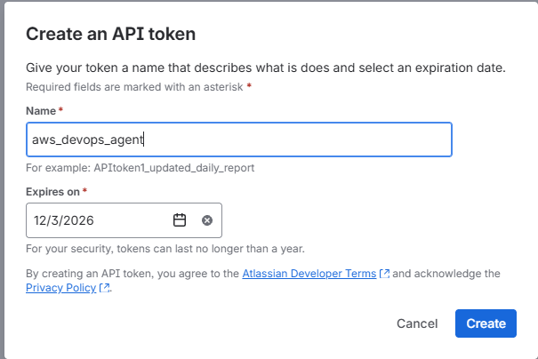
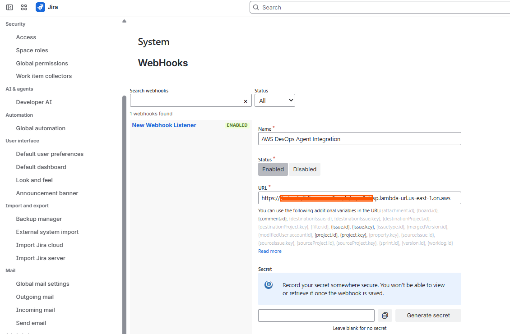
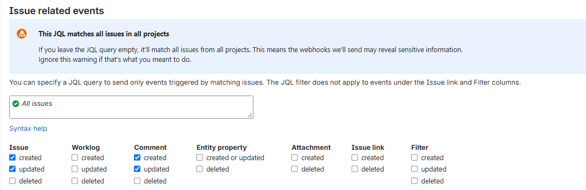

# Jira Cloud Configuration & Incident Management Guide

This guide details all configuration steps required inside **Atlassian Jira Cloud** to enable seamless, bi-directional incident management with **AWS DevOps Agent**.

---

## 1. Atlassian API Token Creation

The integration authenticates using HTTP Basic Authentication with your Atlassian account email and an API token.

1. Navigate to: **[Atlassian Security > API Tokens](https://id.atlassian.com/manage-profile/security/api-tokens)**.
2. Click **Create API token** *(choose the standard option, not "with scopes")*.
3. In the modal:
   - **Name**: `aws_devops_agent`
   - **Expires on**: Select your preferred expiration date (up to 1 year).
4. Click **Create** and copy the token immediately.

<p align="center">
  
</p>

---

## 2. Jira Project Permissions

Ensure the Atlassian user account associated with the API token has sufficient permissions in your target project (e.g. `KAN`, `OPS`, or `INC`):

1. In Jira, navigate to your project.
2. Click **Project settings** (in the left navigation sidebar).
3. Select **Access** (in Team-managed projects) or **Permissions** (in Company-managed projects).
4. Verify your user has at least **Member** or **Administrator** role with the following permissions:
   - ✅ **Browse Projects**: View the project and verify existence.
   - ✅ **Create Issues**: Open automated incident and investigation tickets.
   - ✅ **Add Comments**: Post step-by-step telemetry updates and Root Cause Analysis (RCA) findings.
   - ✅ **Edit Issues**: Update issue labels (e.g. `rca-completed`, `aws-us-east-1`).
   - ✅ **Transition Issues**: Move tickets from *To Do* to *In Progress* / *Done*.

---

## 3. Issue Types Configuration

### A. Team-Managed Software Projects (e.g., Kanban / Scrum)
In **Team-managed software** projects, the default issue types are **`Task`** and **`Bug`**:
- When running the setup wizard, select **`Task`** or **`Bug`** as your active issue type.
- *(Optional)* To add `Incident` to a team-managed project:
  1. Go to **Project settings > Issue types**.
  2. Click **+ Add issue type**.
  3. Name it **`Incident`**, choose an icon, and click **Create**.

### B. Company-Managed / Jira Service Management Projects
In **Company-managed** or **ITSM** projects, issue types like **`Incident`**, **`Problem`**, and **`Service Request`** are already standard:
- Select **`Incident`** when running the setup wizard.

---

## 4. Issue Creation Screen Fields (Avoid Blocking Required Fields)

When the AWS Lambda function creates a ticket via the REST API, it sends:
- **Project**: Target Project Key (e.g. `KAN`)
- **Summary**: Investigation title with symptom
- **Description**: Rich Atlassian Document Format (ADF) context block
- **Issue Type**: e.g. `Task`, `Bug`, or `Incident`
- **Labels**: `aws-devops-agent`, `automated-investigation`

> [!IMPORTANT]
> **Check Required Fields**:  
> In **Project settings > Issue types**, ensure custom fields (such as *Affects Version*, *Component*, or *Assignee*) are **NOT** marked as **Required** on the initial creation screen. If a custom field is marked as strictly Required, Jira will reject API issue creation unless that specific field is provided.

---

## 5. Inbound Webhook Setup (Bi-Directional Incident Management)

To allow engineers to trigger autonomous AWS DevOps Agent investigations directly from Jira:

### Step 5.1: Retrieve the Secured Webhook URL
The webhook URL is protected with a **cryptographic shared secret token** stored in AWS Secrets Manager (`devops-agent/jira-credentials`). Any incoming webhook request lacking this valid token is immediately dropped with **HTTP 403 Forbidden**.

Retrieve the full secured URL from Secrets Manager and CloudFormation:
```bash
WEBHOOK_URL=$(aws cloudformation describe-stacks \
  --stack-name devops-agent-jira-integration \
  --query "Stacks[0].Outputs[?OutputKey=='JiraWebhookUrl'].OutputValue" \
  --output text)

WEBHOOK_TOKEN=$(aws secretsmanager get-secret-value \
  --secret-id "devops-agent/jira-credentials" \
  --query "SecretString" --output text | jq -r '.webhook_secret_token')

echo "Secured Webhook URL: ${WEBHOOK_URL}?token=${WEBHOOK_TOKEN}"
```

*(Example: `https://3ra5eo6jjd5orsf4xvtwy6onbe0dvkyr.lambda-url.us-east-1.on.aws/?token=a1b2c3d4e5f6g7h8i9j0k1l2m3n4o5p6`)*

### Step 5.2: Register the Webhook in Jira
1. In Jira, click the **Settings icon** (gear ⚙️ in the top right header).
2. Click **System**.
3. In the left sidebar, scroll down to **Advanced** and click **Webhooks**.
4. Click **+ Create a Webhook** (top right).
5. Configure the webhook settings:
   - **Name**: `AWS DevOps Agent Integration`
   - **Status**: `Enabled`
   - **URL**: Paste your **Secured Webhook URL** (including the `?token=...` parameter).
   - **Secret**: Leave blank (*"Leave blank for no secret"*, as the cryptographic token in the URL authenticates the payload).

   <p align="center">
     
   </p>

   - **Issue related events**:
     - Check **Issue**: `created`, `updated`
     - Check **Comment**: `created` (and `updated`)

   <p align="center">
     
   </p>

   - *(Optional JQL Filter)*: Restrict events to your project:
     ```jql
     project = "KAN"
     ```
6. Scroll to the bottom of the page and click **Create**.

---

## 6. How Engineers Use the Bi-Directional Integration

This solution supports two core operational workflows:

### 1. Inbound: Trigger AWS DevOps Agent from Jira
* **Trigger on Incident Submission**: Whenever an incident or alert ticket is submitted in Jira (with issue type `Incident`/`Alert`, priority `Highest`/`Critical`, or label `aws-devops-agent`), the solution automatically prompts AWS DevOps Agent to initiate an autonomous diagnostic investigation on your AWS environment.
* **Trigger via Slash Command**: On any existing Jira ticket, comment:
  ```text
  /investigate
  ```
* **Instant Acknowledgment**: The webhook receiver immediately responds to the Jira ticket with an informational comment confirming the assigned AWS DevOps Agent Task ID and console tracking link.

### 2. Outbound: Automatically Create & Update Tickets from Non-Jira Sources
* **Automated Creation from Non-Jira Triggers**: Whenever a new investigation begins in AWS DevOps Agent triggered by **non-Jira sources** (such as Amazon CloudWatch alarms, AWS Console, AWS CLI, automated EventBridge rules, or third-party monitoring), the integration automatically creates a new Jira ticket in your project.
* **Live Investigation Updates**: As the agent analyzes the infrastructure, it posts step-by-step diagnostic progress notes.
* **Root Cause Analysis (RCA)**: When the investigation concludes, the integration appends the full RCA findings, affected resource ARNs, and recommended remediation actions, and attaches the `rca-completed` label.

### 3. What Happens When Someone Updates a Jira Ticket (`jira:issue_updated`)
When engineers interact with or modify an existing Jira ticket, the webhook receiver processes the update according to the action taken:

| Jira Update Action | System Behavior |
| :--- | :--- |
| **Comment with `/investigate`** | **Explicit Trigger**: Dispatches a fresh autonomous AWS DevOps Agent investigation task for the ticket. |
| **Add Label `aws-devops-agent`** | **Initial Launch**: If the ticket was not previously mapped to an active investigation, launches an investigation task and links the ticket. |
| **Ticket Resolved / Closed** | **Lifecycle Sync**: When the status transitions to *Done*, *Resolved*, or *Closed*, the integration updates the tracking state in DynamoDB to `RESOLVED`. |
| **Routine Edits (Assignee, Description, Move Columns)** | **Idempotency Guard**: If the ticket already has an active investigation in progress, routine edits are safely acknowledged (`HTTP 200 already_active`) without spawning duplicate investigations. |
| **Engineer Adds Comments / Details** | **In-Investigation AI Context**: If the **Atlassian Remote MCP Server** is enabled in your DevOps Agent Space, AWS DevOps Agent actively reads newly added comments, rollback notes, and attachments via MCP tools during its live reasoning loop. |

---

## 7. Useful Jira Filters & Dashboards (JQL)

Create saved filters and dashboard gadgets to monitor autonomous AI investigations:

### Active Automated Investigations:
```jql
project = "KAN" AND labels = "aws-devops-agent" AND statusCategory != Done ORDER BY created DESC
```

### Investigations with Completed RCA:
```jql
project = "KAN" AND labels = "rca-completed" ORDER BY updated DESC
```

### Failed or Incomplete Investigations:
```jql
project = "KAN" AND labels = "investigation-failed" ORDER BY updated DESC
```
